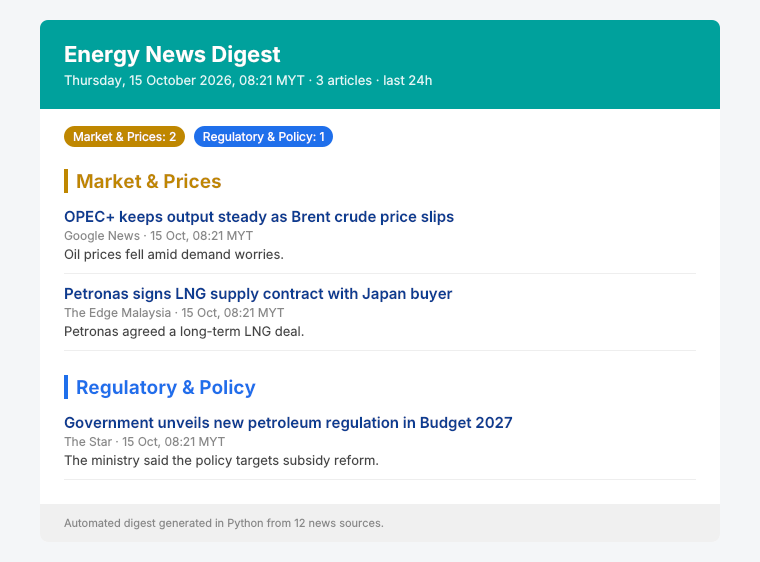
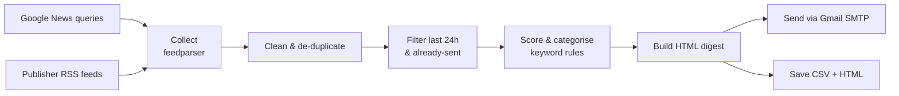

# Energy News Monitor

**Automated news monitoring and email notification system for the energy sector.**

[](https://colab.research.google.com/github/msyxhmx/energy-news-monitor/blob/main/news_monitor.ipynb)


Keeping up with regulatory, policy and geopolitical developments usually means opening a dozen news sites every morning. This project automates that: it collects articles from multiple online sources, filters and ranks them by relevance, and delivers a clean, categorised email digest.

<p align="center">
  
</p>

## Features

- **Multi-source collection**: Google News search feeds plus direct publisher RSS (The Star, Malay Mail, OilPrice.com, Rigzone)
- **De-duplication**: the same story syndicated across outlets appears once
- **Relevance scoring**: keyword rules across five categories (Regulatory & Policy, Geopolitical, Market & Prices, Corporate, Energy Transition); title matches weigh double
- **Recency filter**: only articles from the last 24 hours (configurable)
- **Formatted HTML email**: grouped by category, with source, timestamp (MYT) and summary, plus a plain-text fallback
- **No repeats**: a sent-history file keeps stories from being emailed twice
- **Runs anywhere**: Google Colab notebook, local Python script, or scheduled daily on GitHub Actions

## How it works



## Quick start

### Option 1: Google Colab

1. Click **Open in Colab** above.
2. In the 🔑 **Secrets** panel, add `GMAIL_USER` and `GMAIL_APP_PASSWORD` ([how to create a Gmail App Password](https://support.google.com/accounts/answer/185833)).
3. Set `RECIPIENTS` in the Configuration cell, then **Runtime → Run all**.

### Option 2: Run locally

```bash
git clone https://github.com/msyxhmx/energy-news-monitor.git
cd energy-news-monitor
pip install -r requirements.txt

# preview only (writes output/digest_*.html)
SEND_EMAIL=false python news_monitor.py

# send the email
export GMAIL_USER=you@gmail.com
export GMAIL_APP_PASSWORD=your-app-password
export NEWS_RECIPIENTS=you@gmail.com,colleague@company.com
python news_monitor.py
```

On Windows (PowerShell) use `$env:GMAIL_USER="you@gmail.com"` instead of `export`.

### Option 3: Daily email with GitHub Actions

The included workflow (`.github/workflows/daily-digest.yml`) runs every day at 07:50 MYT.

1. Fork or clone this repo.
2. Go to **Settings → Secrets and variables → Actions** and add `GMAIL_USER`, `GMAIL_APP_PASSWORD` and `NEWS_RECIPIENTS`.
3. Trigger a test run from the **Actions** tab (**Run workflow**).

## Configuration

All settings are at the top of the notebook / script:

| Setting | What it controls |
|---|---|
| `SEARCH_QUERIES` | Google News search topics |
| `DIRECT_FEEDS` | Publisher RSS feeds |
| `CATEGORIES` | Keyword lists per category |
| `MIN_SCORE` | Minimum keyword hits to keep an article |
| `LOOKBACK_HOURS` | Time window for "new" articles |
| `MAX_ARTICLES` | Cap on articles per email |
| `FETCH_SUMMARIES` | Download article pages for fuller summaries (slower) |

Swap the queries and keywords to monitor any industry: finance, healthcare, tech policy, etc.

## Project structure

```
├── news_monitor.ipynb          # Colab notebook (step-by-step, with preview)
├── news_monitor.py             # Standalone script for local / scheduled runs
├── requirements.txt
├── .github/workflows/
│   └── daily-digest.yml        # Scheduled GitHub Actions run
├── data/                       # Sent history (created on first run)
└── assets/email_preview.png
```

## Tech stack

Python · pandas · feedparser · trafilatura · smtplib · Google Colab · GitHub Actions

## Background

Originally built in August 2025 to cut down the manual work of compiling daily industry news updates for internal circulation. The automated workflow made news dissemination faster and more consistent. This repository is a clean, public rebuild of that project.

## License

[MIT](LICENSE)
